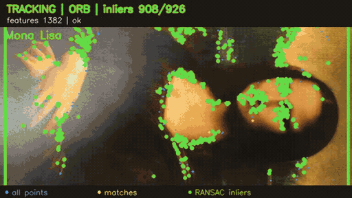
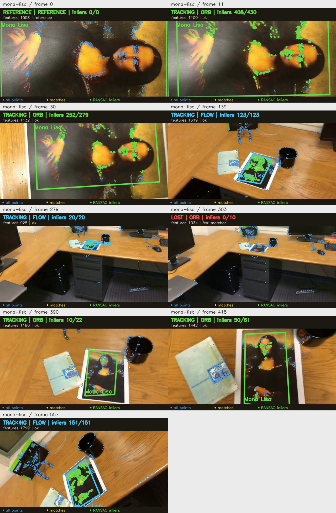
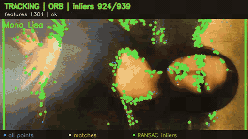
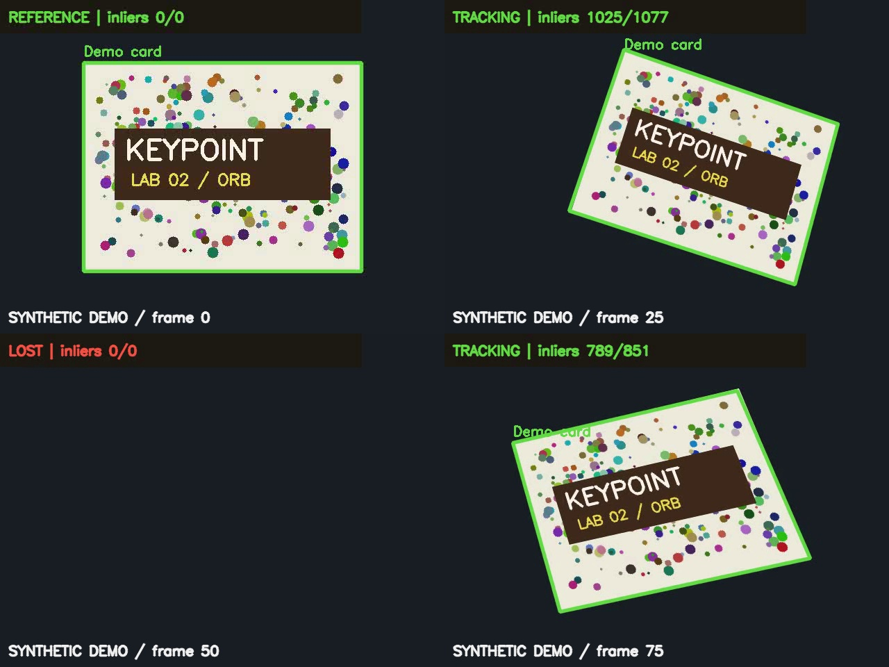

# Трекинг объекта на видео на основе ключевых точек

Лабораторная работа № 2. Программа находит плоский прямоугольный объект на видео
и обводит его рамкой. Рамка учитывает поворот, изменение масштаба и перспективу.

Проект написан на Python с OpenCV и NumPy. Для поиска используются ключевые точки
ORB, сопоставление через BFMatcher, ratio test и гомография с RANSAC.
Если совпадений с эталоном не хватает, точки сопровождаются между кадрами
оптическим потоком Lucas-Kanade, также с проверкой RANSAC.

Программа проверена на сгенерированном видео и трёх тестовых роликах с Моной Лизой.
Сопровождение между кадрами заметно сократило потери при уменьшении объекта,
но не устранило их полностью.
Собственный ролик пока не добавлен.



Зелёная рамка означает поиск по ORB, голубая сопровождение оптическим потоком.
Синим показаны все ORB-точки кадра, жёлтым совпадения, зелёным inlier RANSAC.
GIF показывает обычный тестовый ролик целиком, включая участки LOST.

[Все три GIF-примера](#gif-примеры)
· [Файлы и результаты проверки](results/README.md)

## Установка и запуск

Нужен Python 3.10 или новее. Проект проверен на Windows 11 с Python 3.13.7,
OpenCV 4.14.0 и NumPy 2.5.4. Для выбора объекта мышью нужен доступ к графическому
интерфейсу и пакет `opencv-python`. Версия `opencv-python-headless` для этого не подходит.

В PowerShell откройте корень проекта и выполните:

```powershell
python -m venv .venv
.\.venv\Scripts\python.exe -m pip install -r requirements.txt
.\.venv\Scripts\python.exe demo.py --directory results/demo_local
.\.venv\Scripts\python.exe -m unittest discover -s tests -v
```

Эти команды создадут окружение, установят зависимости, запустят демонстрацию
и тесты. Активировать окружение отдельно не нужно.

Чтобы повторить проверенную среду, используйте Python 3.13 и установите
`numpy==2.5.4 opencv-python==4.14.0.94` вместо диапазонов версий из `requirements.txt`.
Скорость обработки зависит от компьютера и версий библиотек.

В Linux и macOS создайте окружение командой `python3 -m venv .venv`, установите
зависимости через `.venv/bin/python -m pip install -r requirements.txt`
и используйте `.venv/bin/python` для запуска скриптов.

### Запуск на своём видео

Положите видео в `data/` по [инструкции](data/README.md), затем запустите:

```powershell
.\.venv\Scripts\python.exe main.py --input data/videos/mona-lisa.avi --output results/videos/mona-lisa_tracked.mp4 --label "Mona Lisa"
```

Если окружение активировано, достаточно:

```powershell
python main.py --input data/videos/mona-lisa.avi --output results/videos/mona-lisa_tracked.mp4
```

В открывшемся окне выберите объект:

1. Левой кнопкой мыши отметьте четыре угла **по контуру**, по часовой стрелке
   или против неё. Начать можно с любого угла. Стороны не должны пересекаться.
2. Нажмите **Enter**, чтобы подтвердить выбор. Если геометрия неверна, программа
   попросит выбрать углы заново.
3. Чтобы сбросить точки, нажмите **R**. Для отмены нажмите **Q**, **Esc** или закройте окно.

Во время просмотра **Q**, **Esc** или закрытие окна останавливают обработку.
Уже обработанная часть видео и её статистика сохраняются.

Для больших кадров окно выбора уменьшается до 1280×800. Координаты точек
при этом сохраняются в исходном размере. В примере выше выбранные углы
автоматически записываются в `results/videos/mona-lisa_selection.json`.

Для повторного запуска без окон передайте сохранённый выбор:

```powershell
python main.py --input data/videos/mona-lisa.avi --output results/videos/mona-lisa_tracked.mp4 --selection results/videos/mona-lisa_selection.json --no-preview --label "Mona Lisa"
```

JSON содержит размер кадра `frame_size: [ширина, высота]` и четыре пары координат
`corners: [[x, y], …]` в порядке обхода. Используйте его для того же первого кадра:
одинаковый размер двух видео ещё не означает, что выбранные углы подойдут обоим.

Параметр `--no-preview` работает только вместе с `--selection`.
Для подписи `--label` используйте печатные ASCII-символы, например `Book`.

### Точки и цвета на видео

По умолчанию видны все найденные ORB-точки, включая точки фона:

- Синие точки: все признаки текущего кадра.
- Жёлтые точки: совпадения с эталоном или точки, перенесённые оптическим потоком.
- Зелёные точки: inlier, согласованные с гомографией RANSAC.
- Зелёная рамка и надпись `ORB`: объект найден по эталону.
- Голубая рамка и надпись `FLOW`: объект сопровождается между соседними кадрами.

Количество точек на фоне само по себе не помогает найти объект: нужны совпадения
именно с ним. Параметр `--no-show-keypoints` скрывает точки и легенду.
Чтобы сравнить с исходным поиском без межкадрового сопровождения,
передайте `--no-optical-flow`.

### Что сохраняется

Рядом с результатом появляются обработанное видео, покадровая статистика CSV
и сводка JSON. Нужные папки создаются автоматически.

- Поддерживаются MP4 с кодеком `mp4v` и AVI с кодеком `MJPG`.
- Размер кадра и FPS сохраняются. Если FPS отсутствует, бесконечен, не положителен
  или превышает 1000, программа выдаёт предупреждение и использует **25 FPS**.
- Видео с нечётной шириной или высотой отклоняется с объяснением:
  кодек может обрезать край такого кадра без предупреждения.
- Звук не переносится. Видео с переменной частотой кадров записывается с постоянной.
  Время в CSV считается как номер кадра / FPS.
- Повторный запуск с тем же именем заменяет предыдущие результаты.
  Входные файлы не должны совпадать с выходным видео или файлами статистики,
  в том числе через ссылки на один и тот же файл.

При ошибке входного файла, JSON, кодека или параметров программа выводит сообщение
без traceback и завершает работу с кодом `1`. При отмене выбора код равен `0`,
при **Ctrl+C** он равен `130`.

После **Ctrl+C** или ошибки во время обработки могут остаться неполные видео и CSV.
Сводка текущего запуска в этом случае не создаётся. JSON от предыдущего запуска
не описывает такой результат.

### Просмотр результата в VS Code

Видео с кодеком `mp4v`, который использует OpenCV, может не открыться в редакторе.
Для просмотра подготовлены H.264-копии в `results/videos/playback/`.
Например, откройте `results/videos/playback/mona-lisa_tracked.mp4`.

После нового запуска трекера обновите копии:

```powershell
.\.venv\Scripts\python.exe -m pip install -r requirements-preview.txt
.\.venv\Scripts\python.exe prepare_previews.py
```

Скрипт конвертирует исходники из `data/videos/` и результаты из `results/videos/`.
Он сохраняет оригиналы и создаёт копии без звука. Подробнее о форматах
и расширении редактора в [инструкции по просмотру](results/videos/README.md#просмотр-в-vs-code).

## 1. Как работает алгоритм

**Ключевая точка** обозначает заметную деталь изображения, которую можно найти
на другом кадре. **Дескриптор** описывает её окрестность и позволяет сравнивать точки.
Поэтому обложка с рисунком подходит для трекинга лучше однотонного прямоугольника.

**ORB** использует детектор FAST, отбор точек по отклику углов и пирамиду масштабов.
Ориентация окрестности учитывается при построении бинарного дескриптора на основе
BRIEF. Это помогает при вращении и умеренном изменении масштаба.
[Документация ORB](https://docs.opencv.org/4.x/d1/d89/tutorial_py_orb.html).

**BFMatcher** сравнивает дескрипторы по расстоянию Хэмминга, то есть по числу
различающихся битов. KNN находит два ближайших варианта. **Ratio test** оставляет
лучший из них, если `d1 < ratio * d2`. Если расстояния слишком близки,
совпадение считается неоднозначным и отбрасывается. Каждая точка текущего кадра
может участвовать только в одной паре.
[Сопоставление признаков](https://docs.opencv.org/4.x/dc/dc3/tutorial_py_matcher.html).

**Гомография** описывает преобразование плоскости между двумя изображениями.
Для этого используется матрица 3×3, определённая с точностью до масштаба:

```text
s · [x', y', 1]ᵀ = H · [x, y, 1]ᵀ
```

Она подходит для плоской обложки при движении камеры или объекта, если искажения
объектива невелики. Объёмный объект одной гомографией в общем случае описать нельзя.
Для расчёта достаточно четырёх пар точек в невырожденном расположении,
но программа требует больше совпадений, чтобы результат был устойчивее.

**RANSAC** пробует преобразования по небольшим выборкам и выбирает то,
с которым согласуется достаточно пар точек. Такие пары называются **inlier**:
их ошибка репроекции укладывается в заданный порог. Найденная матрица переносит
четыре исходных угла на текущий кадр. Из них строится рамка с учётом перспективы.
[Пример гомографии и RANSAC](https://docs.opencv.org/4.x/d1/de0/tutorial_py_feature_homography.html).

**Оптический поток Lucas-Kanade** переносит точки с предыдущего кадра на текущий.
Для него внутри найденной рамки выбираются углы Shi-Tomasi. Чтобы отсеять ошибки,
точки проверяются движением вперёд и обратно: расхождение должно быть меньше пикселя.
Затем RANSAC оценивает гомографию по оставшимся соответствиям.
[Документация оптического потока](https://docs.opencv.org/4.x/d4/dee/tutorial_optical_flow.html).

## 2. Устройство проекта

| Файл / функция | Назначение |
| --- | --- |
| `main.py: build_parser` | Аргументы запуска и настройки |
| `main.py: process_video` | Чтение первого кадра, основной цикл, запись, CSV/JSON, освобождение ресурсов |
| `selection.py: choose_corners` | Выбор четырёх углов мышью и подтверждение |
| `selection.py: save_selection / load_selection` | JSON, проверка размера и геометрии |
| `tracker.py: KeypointTracker.__init__` | ORB по маске выбранного объекта первого кадра |
| `tracker.py: KeypointTracker.detect` | Поиск ORB, запасное сопровождение LK, обновление точек |
| `tracker.py: KeypointTracker._estimate` | RANSAC и проверка геометрии рамки |
| `tracker.py: valid_quad` | Проверка конечности, выпуклости, площади и пересечения с кадром |
| `tracker.py: draw_detection` | Рамка, подпись, статус, число inlier |
| `demo.py` | Генерация ролика с известной геометрией и проверка результата |
| `prepare_previews.py` | H.264-копии исходников и результатов для просмотра в редакторе |
| `make_gifs.py` | GIF трёх обработанных роликов для README |
| `tests/test_tracking.py` | Автоматические проверки алгоритма, ввода и записи видео |

Эталоном служит выбранный объект на первом кадре. Опорные точки ищутся только
внутри его четырёхугольника, поэтому фон за пределами объекта в эталон не попадает.
Сам кадр не обрезается: все координаты относятся к исходному изображению.

Каждый следующий кадр сравнивается с тем же эталоном. Если ORB не даёт надёжную
рамку, программа пробует сопровождение точек с предыдущего кадра. Для обоих путей
действуют пороги числа совпадений, inlier и проверки геометрии. Для FLOW дополнительно
проверяется, что опорные точки не сосредоточены в одном маленьком пятне.

После успешного обнаружения точки для следующего шага выбираются заново внутри
рамки. Их координаты в системе эталона получаются через обратную гомографию.
Поэтому в режиме FLOW может накапливаться дрейф. Успешный поиск ORB снова
привязывает рамку к исходному эталону.

Если оба пути не дают результат, программа показывает **LOST**, убирает рамку
и сбрасывает старые точки сопровождения. Поиск ORB по всему изображению продолжается,
чтобы найти объект после возвращения.

Дополнительно исключаются гомографии с проективным горизонтом внутри объекта.
Частичный выход за изображение разрешён, если рамка ещё пересекает кадр.
Допустимые координаты ограничены десятикратным размером кадра, чтобы отсечь
численно нестабильные результаты. Эти проверки снижают риск ложной рамки,
но не гарантируют, что объект найден правильно.

### Настройки

Параметры задаются при запуске. Полный список доступен по команде `python main.py --help`.

| Аргумент | По умолчанию | Значение |
| --- | ---: | --- |
| `--nfeatures` | 2500 | Максимум признаков ORB |
| `--scale-factor` | 1.2 | Шаг масштаба пирамиды |
| `--nlevels` | 8 | Число уровней пирамиды |
| `--fast-threshold` | 15 | Порог детектора FAST |
| `--ratio` | 0.75 | Фильтрация неоднозначных совпадений |
| `--min-matches` | 12 | Минимум пар для попытки RANSAC |
| `--min-inliers` | 10 | Минимум согласованных пар |
| `--min-inlier-ratio` | 0.45 | Минимальная доля согласованных пар |
| `--ransac-threshold` | 3.0 | Допустимая ошибка репроекции, пиксели |
| `--min-area-ratio` | 0.001 | Минимум площади рамки / площади кадра |
| `--max-area-ratio` | 1.5 | Максимум площади рамки / площади кадра |
| `--optical-flow` | True | Сопровождение LK при неудачном поиске ORB; отключается через `--no-optical-flow` |

Начать можно со значений по умолчанию. Чем больше признаков, тем дольше идёт
сопоставление. Увеличение `--ratio` пропускает больше пар, в том числе ошибочных.
Порог RANSAC задаётся в пикселях, поэтому зависит от разрешения видео.
Подбирайте настройки по результату на конкретном ролике и сохраняйте их вместе с ним.

### Статистика

В CSV записываются `frame` (номер кадра с нуля), `video_time_s`, `status`,
`matches`, `inliers`, `inlier_ratio`, `processing_ms`, `reason`, `method` и `keypoints`.
Поле `reason` объясняет статус LOST: например, не хватило признаков
или совпадений либо не прошла проверка геометрии.

Кадр 0 записывается в видео и CSV как **REFERENCE**. Он задан пользователем
и исключён из `processed_frames`, `detected_frames`, доли обнаружений и среднего времени.
`written_frames` включает эталон. Видео из одного кадра имеет нулевые метрики поиска.

JSON содержит числа обработанных и найденных кадров, `detection_rate`,
`mean_processing_ms`, `processing_fps`, `pipeline_fps`, FPS/размер видео,
параметры трекера, `tracking_methods` (число успешных кадров ORB и FLOW),
`show_keypoints` и признак остановки пользователем. Время обработки кадра включает
поиск и отрисовку, но исключает декодирование, запись и ожидание GUI.
`processing_fps = 1000 / mean_processing_ms`. `pipeline_fps` учитывает цикл ввода/вывода
и просмотр, исключая выбор эталона; это отдельный ориентир производительности.

**Доля обнаруженных кадров не показывает точность рамки.** Без разметки нельзя
сказать, верно ли она построена. Если объекта в кадре нет, статус LOST корректен,
хотя доля TRACKING при этом снижается. Чтобы оценить положение рамки, нужны
размеченные углы или маски. В демонстрации ниже точные углы известны из генератора.

## 3. Результаты и проверка

### Реальные видео

Проверка выполнена 21.10.2026 с настройками по умолчанию. Входные файлы находятся
в `data/videos/`, обработанные видео, CSV, JSON и примеры кадров в `results/videos/`.
Все три исходных ролика имеют размер 640×360, частоту 29,97 FPS и длину 558 кадров.
Первый кадр используется как эталон, поэтому поиск выполняется на 557 кадрах.

| Видео | Условия | Кадров со статусом TRACKING | LOST | Среднее время кадра |
| --- | --- | ---: | ---: | ---: |
| `mona-lisa.avi` | Изменение масштаба, поворота и перспективы | 470 / 557 (84,38%) | 87 | 31,63 мс |
| `mona-lisa-blur.avi` | Та же сцена с размытием | 451 / 557 (80,97%) | 106 | 46,32 мс |
| `mona-lisa-blur-extra-credit.avi` | Та же сцена с более сильным размытием | 529 / 557 (94,97%) | 28 | 47,44 мс |

На первом кадре репродукция занимает почти всё изображение, а края листа не видны.
Поэтому эталон выбран по видимой области с отступом 5 пикселей от границ кадра.
Рамка отслеживает эту область изображения, а не внешний белый край листа.
Координаты выбора сохранены для повторного запуска.

Исходный поиск только по ORB выдавал рамку на 35,19%, 31,78% и 29,26% кадров
соответственно. На дальнем плане совпадений с крупным эталоном не хватало.
Сопровождение LK удерживает объект на большей части таких кадров. В обычном
ролике остаётся потеря с кадра 303 по кадр 389, восстановление происходит на кадре 390.
Сильный смаз вызывает отдельные потери в размытых роликах. В просмотренных
кадрах с успешным обнаружением рамка следует области репродукции.
Метрики не монотонны по степени размытия: FLOW зависит от всей истории
кадров и предыдущих оценок рамки, а не только от текущего кадра.

Все кадры входных и выходных видео прочитаны, размер, FPS и число кадров проверены.
Также проверены H.264-копии результатов. Вручную просмотрены начало, четверть,
середина, три четверти, конец и первые моменты потери и восстановления.
Доля TRACKING здесь не является точностью: ручной разметки границ нет.



[Подробные результаты и команды повторного запуска](results/videos/README.md)
· [Измерения и интервалы потери](results/videos/evaluation.json)

Файл `simple_track.avi` уже содержит рамку, подпись и ключевые точки, поэтому
рассматривается как образец результата. Он обработан отдельно и не учитывается
в сравнении трёх исходных роликов. Собственную съёмку ещё нужно добавить и проверить.

### GIF-примеры

Все три анимации сделаны из результатов с точками и FLOW. Они показывают полные
ролики длительностью около 18,6 секунды в исходном темпе. Для быстрой загрузки
размер уменьшен до 512×288, частота до 6 кадров/с. GIF зациклены.

**Обычный ролик:** [GIF в начале README](results/videos/gifs/mona-lisa.gif).

**Размытие**


**Сильное размытие**



Чтобы обновить GIF после повторной обработки трёх исходных видео:

```powershell
.\.venv\Scripts\python.exe -m pip install -r requirements-preview.txt
.\.venv\Scripts\python.exe make_gifs.py
```

Скрипт читает `results/videos/<имя>_tracked.mp4` и сохраняет анимации
в `results/videos/gifs/`. Используется системный FFmpeg или копия из `imageio-ffmpeg`.

### Проверка на сгенерированном видео до добавления FLOW



[Синтетическое демонстрационное видео](results/demo/synthetic_tracked.mp4)

17.10.2026, Windows 11, Intel Core i5-13420H, Python 3.13.7, OpenCV 4.14.0,
NumPy 2.5.4. Генератор с seed 2026 создаёт текстурированную карточку, перемещение,
поворот, изменение масштаба, перспективу и полное исчезновение с кадра 45 по кадр 59.
Ниже приведены измерения этого запуска.

| Метрика | Результат |
| --- | ---: |
| Вход / выход | 640×480, 25 FPS, 90 кадров |
| Обработано после эталона | 89 |
| TRACKING | 74 (83,15% от 89) |
| Обнаружено на кадрах с видимым объектом | 74 из 74 |
| Кадры без объекта | 15; ложных обнаружений 0 |
| Средняя ошибка угла относительно генератора | 0,768 пикселя |
| Максимальная ошибка отдельного угла | 3,682 пикселя |
| Среднее время поиска и отрисовки | 19,87 мс |
| Скорость поиска и отрисовки | 50,34 кадр/с |
| Скорость всего цикла без окон | 45,99 кадр/с |

Ошибка рассчитана по четырём углам на каждом кадре, где объект был найден,
после декодирования входного MP4. Проверены исчезновение и возвращение объекта.
Все 90 кадров выходного видео прочитаны повторно, размер и FPS проверены.
Кадры 0, 25, 50 и 75 просмотрены вручную и показаны выше.
[Исходные измерения](results/demo/evaluation.json),
[сводка производительности](results/demo/synthetic_tracked_summary.json).
Сцена проста и не содержит реальных бликов, смаза и сложного фона: результат
не переносится автоматически на реальные видео.

### Автоматические тесты

При проверке командой `python -m unittest discover -s tests -v` пройден **21 тест**.
Проверяются известная перспектива (максимальная ошибка угла < 5 пикселей),
частичный выход за кадр, потеря/восстановление, отсутствие признаков,
недостаток совпадений и inlier, отказ гомографии, неверные параметры,
JSON, отмена и подтверждение выбора, неверный путь, нечитаемое видео,
конфликт путей, отказ VideoWriter, резервный FPS, покадровый CSV,
исключение эталона из статистики и чтение записанного видео.
Дополнительно проверены сопровождение постепенно уменьшающегося объекта
с известными углами при отключённом сопоставлении ORB, сброс FLOW при исчезновении,
повторное обнаружение по эталону и отключение оптического потока.
Выбор углов проверен с имитацией событий мыши и клавиатуры.
Ручная проверка окна мышью в рамках этой проверки не проводилась.

## 4. Выводы и ограничения

Программа находит объект по ключевым точкам эталона, строит рамку с учётом перспективы
и может найти объект снова после потери. На сгенерированном видео проверены
координаты, запись результата и статистики, а также отсутствие ложных обнаружений
на кадрах без объекта. Добавление межкадрового сопровождения повысило долю
обнаружений на трёх реальных роликах, но не устранило потери полностью.
Точность границ без ручной разметки не оценивалась. Остаются проверка
на собственной съёмке и оценка дрейфа на длинных последовательностях.

У алгоритма есть ограничения:

- ORB нужны различимые детали. Размытие, блики, однотонная поверхность и маленький
  размер объекта уменьшают число устойчивых признаков.
- Перекрытия и сильное изменение ракурса могут оставить слишком мало совпадений.
- Повторяющийся рисунок создаёт неоднозначные пары. RANSAC и фильтры снижают
  риск ложных рамок, но полностью его не убирают.
- Гомография не учитывает изгиб объекта и значительные искажения объектива.
- Рамка может дрожать: сглаживание не применяется. В режиме FLOW возможен дрейф,
  особенно при слишком маленьком объекте или ошибках межкадрового переноса точек.

Когда совпадений недостаточно или геометрия не проходит проверку,
программа показывает LOST и продолжает поиск.

## 5. Источники

Официальная документация OpenCV:

1. [ORB: Oriented FAST and Rotated BRIEF](https://docs.opencv.org/4.x/d1/d89/tutorial_py_orb.html): устройство ORB и ссылка на работу Rublee et al., ICCV 2011.
2. [Feature Matching](https://docs.opencv.org/4.x/dc/dc3/tutorial_py_matcher.html): BFMatcher, расстояние Хэмминга, KNN и ratio test.
3. [Feature Matching + Homography to find Objects](https://docs.opencv.org/4.x/d1/de0/tutorial_py_feature_homography.html): findHomography, RANSAC, маска inlier и проекция углов.
4. [Optical Flow](https://docs.opencv.org/4.x/d4/dee/tutorial_optical_flow.html): углы Shi-Tomasi и пирамидальный Lucas-Kanade.
