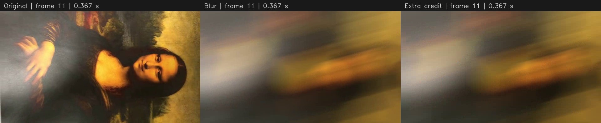
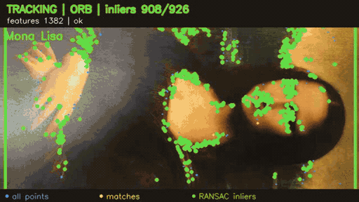
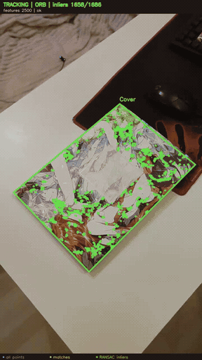

# Трекинг объекта на видео

Лабораторная работа № 2. Программа отслеживает плоский прямоугольный объект
и рисует вокруг него рамку с подписью. Написана на Python с OpenCV и NumPy.

## Запуск

Нужен Python 3.10 или новее. В PowerShell из папки проекта:

```powershell
python -m venv .venv
.\.venv\Scripts\python.exe -m pip install -r requirements.txt
```

Запуск на собственном видео:

```powershell
.\.venv\Scripts\python.exe main.py --input data/videos/test_cv.mp4 --output results/videos/test_cv_tracked.mp4 --label Cover
```

На первом кадре нажмите мышью на **четыре угла объекта по контуру**, затем **Enter**.
Клавиша **R** сбрасывает выбор, **Q** или **Esc** завершает работу.
Для другого ролика замените путь после `--input` и имя результата после `--output`.

Программа сохраняет обработанное видео, статистику по кадрам в CSV и сводку в JSON.
Готовый результат собственной съёмки можно [открыть здесь](results/videos/playback/test_cv_tracked.mp4).

Если новое видео не открывается в VS Code, подготовьте совместимую MP4-копию:

```powershell
.\.venv\Scripts\python.exe -m pip install -r requirements-preview.txt
.\.venv\Scripts\python.exe prepare_previews.py
```

Она появится в `results/videos/playback/`.

## 1. Теоретическая база

**Ключевые точки** — заметные детали изображения, которые можно найти на разных кадрах.
**Дескрипторы** описывают окрестности этих точек и позволяют сопоставлять их между собой.
В проекте используются ORB и BFMatcher. Неоднозначные совпадения отбрасываются через ratio test.

По найденным соответствиям вычисляется **гомография** — преобразование плоскости,
учитывающее поворот, масштаб и перспективу. **RANSAC** отсеивает ошибочные соответствия.
Если совпадений ORB недостаточно, **оптический поток Lucas–Kanade** переносит точки
с предыдущего кадра на текущий.

## 2. Описание системы

Алгоритм работает так:

1. Пользователь выделяет объект на первом кадре. Он становится эталоном.
2. ORB находит ключевые точки внутри выделенной области и на следующих кадрах.
3. По совпадениям с эталоном вычисляются новые координаты четырёх углов объекта.
4. Если поиск по ORB не удался, программа пробует сопровождение оптическим потоком.
5. При успешном поиске рисуется рамка. При потере показывается `LOST`, поиск продолжается.

Зелёная рамка означает поиск по ORB, голубая — сопровождение оптическим потоком (`FLOW`).
Синие точки показывают найденные признаки, жёлтые — совпадения, зелёные — точки,
прошедшие проверку RANSAC.

| Файл | Назначение |
| --- | --- |
| `main.py` | Чтение видео, основной цикл, сохранение результатов |
| `selection.py` | Выбор углов объекта и сохранение выбора |
| `tracker.py` | Поиск объекта, сопровождение и отрисовка |
| `prepare_previews.py` | Подготовка MP4 для просмотра |
| `make_gifs.py` | Создание GIF для отчёта |
| `verify_videos.py` | Проверка полных видео, статистики и различий исходников |
| `tests/test_tracking.py` | Автоматические тесты |

Все настройки доступны по команде `.\.venv\Scripts\python.exe main.py --help`.

## 3. Результаты и тестирование

Проверены три тестовых ролика с Моной Лизой и собственное видео.
В таблице указаны кадры после первого: первый кадр задаёт эталон и не участвует в оценке.

| Видео | Кадров с рамкой | Доля | Кадров LOST |
| --- | ---: | ---: | ---: |
| `mona-lisa.avi` | 470 / 557 | 84,38% | 87 |
| `mona-lisa-blur.avi` | 451 / 557 | 80,97% | 106 |
| `mona-lisa-blur-extra-credit.avi` | 529 / 557 | 94,97% | 28 |
| `test_cv.mp4` — собственное видео | 451 / 451 | 100% | 0 |

Доля кадров с рамкой показывает, как часто объект был найден, но не измеряет точность его границ.
Покадровая разметка углов для этих видео отсутствует.

### Тестовые видео

В роликах меняются масштаб, поворот и перспектива объекта. Проверка выполнена 21.10.2026.
Оптический поток помогает удерживать рамку при уменьшении объекта, но потери остаются.
В обычном ролике рамка отсутствует на кадрах 303–389 и восстанавливается на кадре 390.
Эталоном выбрана видимая область репродукции на первом кадре, а не внешний край листа.

Это три варианта **одной съёмки**, поэтому сцена и движение камеры совпадают.
Покадровое сравнение исходных AVI показало: обычный ролик и `mona-lisa-blur.avi`
отличаются только на кадрах **10–35** (примерно 0,33–1,17 с, нумерация с нуля).
Остальные 532 кадра совпадают полностью. Версия `extra-credit` отличается
на всех 558 кадрах, но также показывает ту же сцену; название не означает,
что размытие сильнее на всём протяжении видео.

Ниже один и тот же кадр № 11: слева исходный вариант, в центре `blur`, справа `extra-credit`.



| Вариант | Полное обработанное видео (MP4) | GIF-превью |
| --- | --- | --- |
| Обычный | [Смотреть / скачать](results/videos/playback/mona-lisa_tracked.mp4) | [GIF](results/videos/gifs/mona-lisa.gif) |
| Размытие | [Смотреть / скачать](results/videos/playback/mona-lisa-blur_tracked.mp4) | [GIF](results/videos/gifs/mona-lisa-blur.gif) |
| Дополнительный вариант (`extra-credit`) | [Смотреть / скачать](results/videos/playback/mona-lisa-blur-extra-credit_tracked.mp4) | [GIF](results/videos/gifs/mona-lisa-blur-extra-credit.gif) |



[Измерения и интервалы потерь](results/videos/evaluation.json).
Все четыре полных обработанных MP4, GIF и статистика включены в Git.
Исходные тестовые AVI находятся локально в `data/videos/`.
Хеши, проверка декодирования всех кадров и сопоставление со статистикой:
[проверка MP4](results/videos/playback_verification.json).
Точные интервалы различий исходников: [покадровое сравнение](results/videos/source_comparison.json).

```powershell
.\.venv\Scripts\python.exe verify_videos.py
# При наличии трёх исходных AVI — также повторить сравнение:
.\.venv\Scripts\python.exe verify_videos.py --compare-sources
```

### Собственное видео

30.10.2026 проверена съёмка обложки с рисунком на столе: 720×1280, около 30 FPS,
15 секунд. Камера отдаляется и приближается, меняются масштаб и ракурс.



[Исходное видео](data/videos/test_cv.mp4)
· [Обработанное видео](results/videos/playback/test_cv_tracked.mp4)
· [Статистика](results/videos/test_cv_tracked_summary.json)

Рамка получена на всех 451 кадре после эталона. На просмотренных кадрах она следует
контуру обложки. Хватало совпадений ORB, поэтому FLOW не потребовался.
Все 452 кадра результата сохранены. Исчезновение объекта в этом ролике не проверялось.

### Автоматические тесты

Пройден **21 тест**: проверяются геометрия рамки, потеря и восстановление объекта,
оптический поток, выбор углов, обработка ошибок и запись видео.

```powershell
.\.venv\Scripts\python.exe -m unittest discover -s tests -v
```

## 4. Выводы

Программа отслеживает объект при изменении положения, масштаба и перспективы.
На собственной съёмке потерь нет. На тестовых видео оптический поток улучшает
сопровождение, однако полностью устранить потери не удалось.

Лучше всего подходят объекты с чётким рисунком. Сильное размытие, блики,
перекрытия и маленький размер объекта затрудняют поиск. При сопровождении
оптическим потоком возможны дрожание и постепенное смещение рамки.

## 5. Использованные источники

1. [OpenCV: ORB](https://docs.opencv.org/4.x/d1/d89/tutorial_py_orb.html).
2. [OpenCV: сопоставление признаков](https://docs.opencv.org/4.x/dc/dc3/tutorial_py_matcher.html).
3. [OpenCV: гомография и RANSAC](https://docs.opencv.org/4.x/d1/de0/tutorial_py_feature_homography.html).
4. [OpenCV: оптический поток](https://docs.opencv.org/4.x/d4/dee/tutorial_optical_flow.html).
