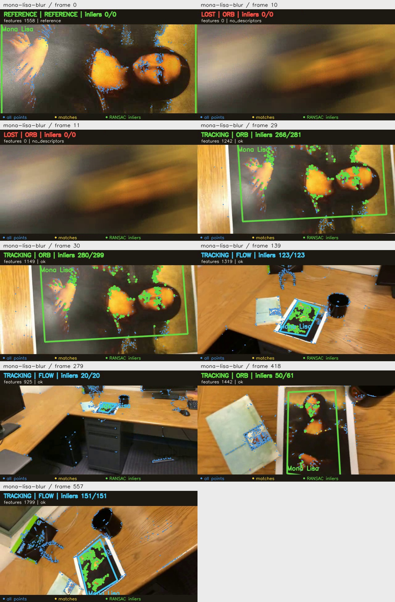
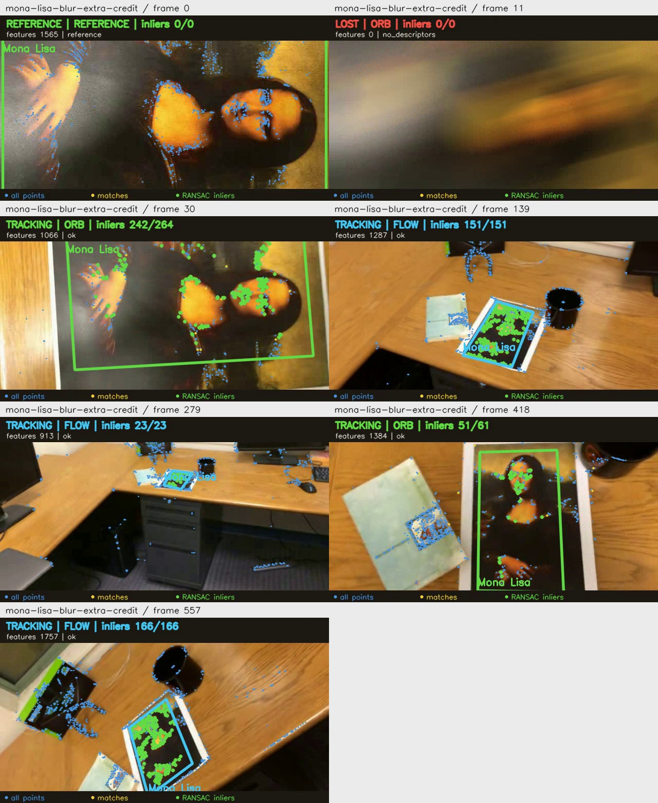
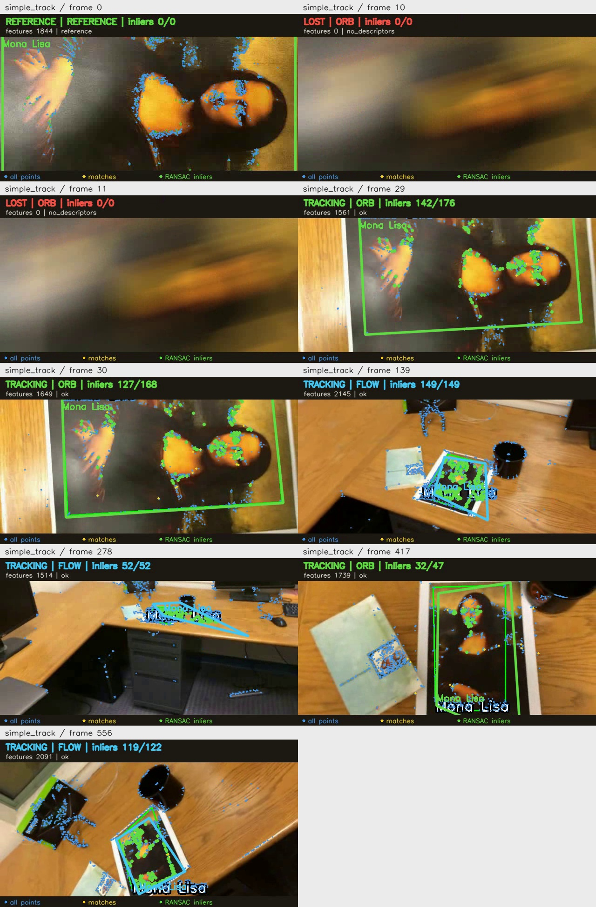

# Проверка добавленных видео

Дата проверки: 21.10.2026. Исходники находятся в `data/videos/`.
Трекер запускался с настройками по умолчанию, без окон. Первый кадр служил
эталоном и не учитывался в доле обнаружений. Для RANSAC задан seed 2026.

## Результаты

| Видео | TRACKING после эталона | LOST | До добавления FLOW | С FLOW и точками | Среднее время кадра |
| --- | ---: | ---: | ---: | ---: | ---: |
| `mona-lisa.avi` | 470 / 557 | 87 | 35,19% | 84,38% | 31,63 мс |
| `mona-lisa-blur.avi` | 451 / 557 | 106 | 31,78% | 80,97% | 46,32 мс |
| `mona-lisa-blur-extra-credit.avi` | 529 / 557 | 28 | 29,26% | 94,97% | 47,44 мс |
| `simple_track.avi`, образец с готовой разметкой | 528 / 556 | 28 | 24,10% | 94,96% | 34,09 мс |

Три исходных ролика содержат по 558 кадров, образец 557. Старые метрики,
покадровая статистика и иллюстрации сохранены в [baseline/](baseline/README.md).

Размер всех роликов 640×360. Частота исходных трёх видео 29,97 FPS,
у `simple_track.avi` она равна 30 FPS. Длительность около 18,6 секунды.

`simple_track.avi` уже содержит зелёную рамку, подпись и ключевые точки.
По содержимому это образец результата. Повторная обработка такого видео
не заменяет проверку на исходнике: нанесённые линии меняют признаки изображения.
Этот файл не считается собственной съёмкой.

Доля TRACKING показывает, как часто программа выдала рамку, а не точность её положения.
Размеченных границ для этих видео нет, поэтому ошибка углов и число ложных рамок
не оценивались. Время обработки включает поиск и отрисовку, без чтения и записи видео.
Разница во времени между запусками также зависит от нагрузки компьютера.

## Выбор объекта

Первый кадр показывает крупный фрагмент репродукции, края листа находятся за кадром.
Для всех четырёх роликов выбрана видимая область с отступом 5 пикселей:

```json
{"frame_size": [640, 360], "corners": [[5, 5], [634, 5], [634, 354], [5, 354]]}
```

Рамка относится к этой области репродукции, а не ко всему листу с белыми полями.
У каждого ролика сохранён отдельный `<имя>_selection.json`.

## Наблюдения

Раньше каждый кадр независимо сопоставлялся с крупным первым кадром. Когда объект
уменьшался, подходящих пар ORB становилось слишком мало. Например, надпись `0/9`
в старом видео означала 9 пар после фильтрации при минимуме 12. До RANSAC
программа в этом случае не доходила, поэтому число inlier оставалось нулевым.

Теперь при неудачном поиске ORB используется оптический поток Lucas-Kanade:
точки переносятся между соседними кадрами, проходят проверку вперёд и обратно,
а затем RANSAC. Это позволяет сопровождать уже найденный объект на дальнем плане.
Поиск ORB по всему кадру продолжается и восстанавливает рамку после потери.

В обычном ролике потеря сократилась до кадров 303 по 389. Восстановление происходит
на кадре 390. У размытого варианта остались потери на кадрах 10 по 28 и 303 по 389.
У самого размытого варианта потери на кадрах 11 по 29 и 391 по 399.
На этих участках слишком мало устойчивых признаков или их нельзя надёжно перенести.

Доля TRACKING не обязана монотонно снижаться с размытием: FLOW зависит от предыдущих
оценок рамки и обновления опорных точек. Более высокая доля не означает лучшую точность.
На просмотренных кадрах трёх исходников рамка следует репродукции. У образца
`simple_track.avi` на кадре 278 заметна неверная рамка: нанесённые подписи и линии
мешают сопровождению. Это пример ложного TRACKING, который одной долей обнаружений не выявить.

Синим показаны все ORB-точки, в том числе фоновые. Жёлтым показаны сопоставленные
или перенесённые точки, зелёным inlier RANSAC. Рамка зелёная для ORB и голубая
для FLOW. Ни большое число фоновых точек, ни большое число inlier сами по себе
не гарантируют правильное положение объекта. В режиме FLOW возможен дрейф.

Проверены чтение всех исходных кадров и всех кадров результатов MP4 и H.264-копий,
сохранение размера, FPS и числа кадров, а также число строк CSV.
На трёх исходных роликах сохранены все 558 кадров, на образце все 557.
Вручную просмотрены кадры из раздела ниже: начало, четверть, середина,
три четверти и конец ролика, первые потеря и восстановление.
Точные номера, все интервалы потерь и параметры находятся в [evaluation.json](evaluation.json).

## GIF для просмотра на GitHub

Анимации содержат весь результат обработки с точками, рамкой и статусами.
Длительность около 18,6 секунды, размер 512×288, частота 6 кадров/с, повтор бесконечный.

- [Обычный ролик](gifs/mona-lisa.gif).
- [Размытие](gifs/mona-lisa-blur.gif).
- [Сильное размытие](gifs/mona-lisa-blur-extra-credit.gif).

Они встроены в [основной README](../../README.md#gif-примеры).
После обработки видео обновите их из корня проекта:

```powershell
.\.venv\Scripts\python.exe -m pip install -r requirements-preview.txt
.\.venv\Scripts\python.exe make_gifs.py
```

Скрипт читает три `*_tracked.mp4` из этой папки. GIF сохраняются в Git вместе с отчётом.

## Примеры кадров

### Обычный ролик


### Размытие



### Сильное размытие



### Образец с готовой разметкой



## Повторный запуск

Из корня проекта в PowerShell, без активации окружения:

```powershell
$videoNames = @('mona-lisa', 'mona-lisa-blur', 'mona-lisa-blur-extra-credit', 'simple_track')
foreach ($name in $videoNames) {
    .\.venv\Scripts\python.exe main.py --input "data/videos/$name.avi" --output "results/videos/${name}_tracked.mp4" --selection "results/videos/${name}_selection.json" --no-preview --label "Mona Lisa"
}
```

Это повторит обработку с сохранёнными углами, точками и FLOW и перезапишет MP4,
CSV и сводки. Параметр `--no-show-keypoints` скрывает точки и легенду,
а `--no-optical-flow` отключает сопровождение для сравнения с исходным методом.
Измерения времени зависят от компьютера и нагрузки. Иллюстрации подготовлены
отдельно при проверке; эта команда их не обновляет.

## Просмотр в VS Code

Для просмотра подготовлены MP4-копии с кодеком H.264, форматом пикселей `yuv420p`
и заголовком в начале файла (`faststart`). Они находятся в `results/videos/playback/`:

- `<имя>.mp4`: копия исходного ролика;
- `<имя>_tracked.mp4`: копия результата с нашей рамкой и статусом.

Например, откройте `results/videos/playback/mona-lisa_tracked.mp4`.
Оригиналы AVI и результаты OpenCV в родительской папке сохранены отдельно.
Копии создаются без звука; метрики трекера при конвертации не пересчитываются.
У всех восьми копий проверены H.264, `yuv420p`, расположение заголовка, FPS,
размер и чтение каждого кадра. [Результат проверки файлов](playback_verification.json).

Для повторного создания копий после обработки новых видео:

```powershell
.\.venv\Scripts\python.exe -m pip install -r requirements-preview.txt
.\.venv\Scripts\python.exe prepare_previews.py
```

Скрипт берёт исходники из `data/videos/` и результаты `*_tracked.mp4` из `results/videos/`.
Для конвертации используется системный FFmpeg, если он доступен, либо FFmpeg
из пакета `imageio-ffmpeg`. Готовые копии в `playback/` заменяются после успешной конвертации.

Подойдёт [Video Preview (Player) от BNPL](https://marketplace.visualstudio.com/items?itemName=BatchNepal.vscode-video-preview),
идентификатор `BatchNepal.vscode-video-preview`. Если возникает ошибка
`Failed to load video or unsupported codec`, откройте H.264-копию из `playback/`.
Расширение версии 0.2.0 конвертирует AVI через внешний FFmpeg; без него исходный
AVI может не открыться. MP4, записанный OpenCV с кодеком `mp4v`, тоже может
не поддерживаться проигрывателем: одного расширения `.mp4` недостаточно.

Старые WebM-копии до добавления точек и FLOW перенесены в `baseline/`.
Текущий вариант для просмотра находится в `playback/`. Если файл уже был открыт
в редакторе, закройте старую вкладку и откройте его заново.

Видео остаются локальными и исключены из Git. Для отчёта сохраняются этот текст,
GIF, примеры кадров, выбранные углы, покадровая статистика, сводки и `evaluation.json`.
Собственную съёмку ещё нужно добавить и проверить.
